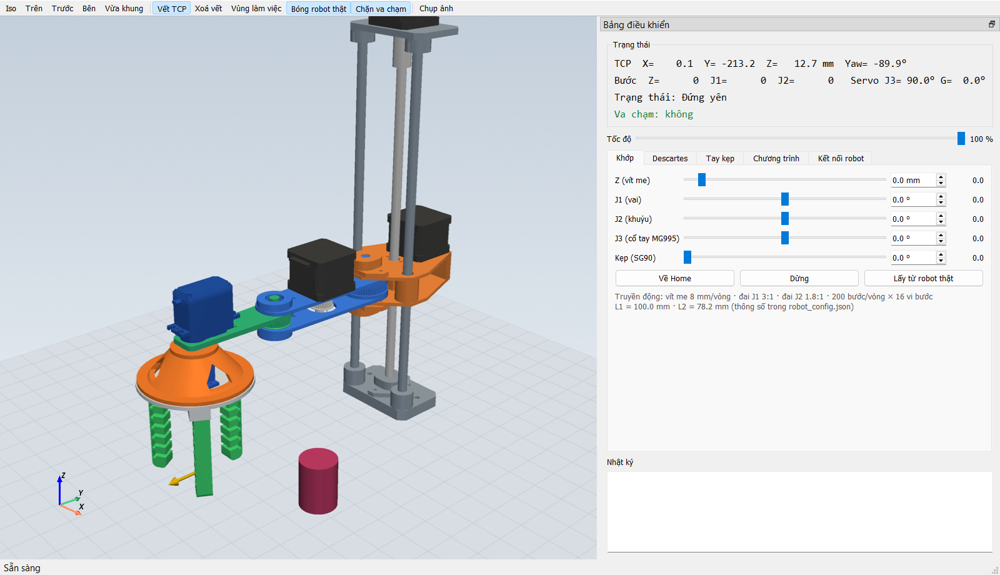
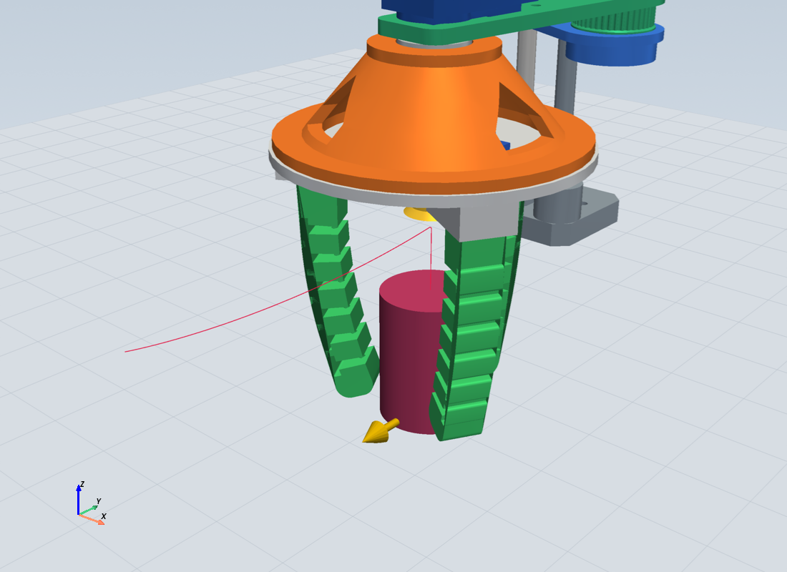
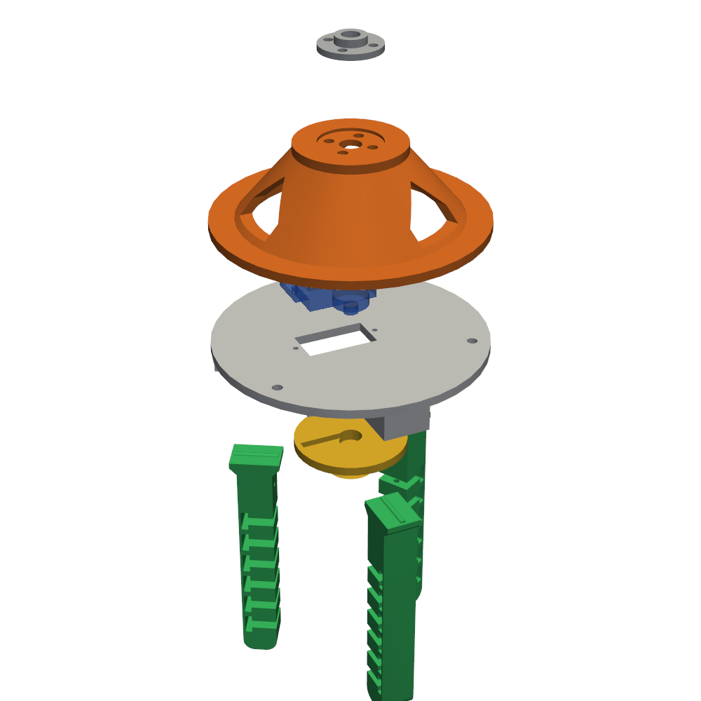
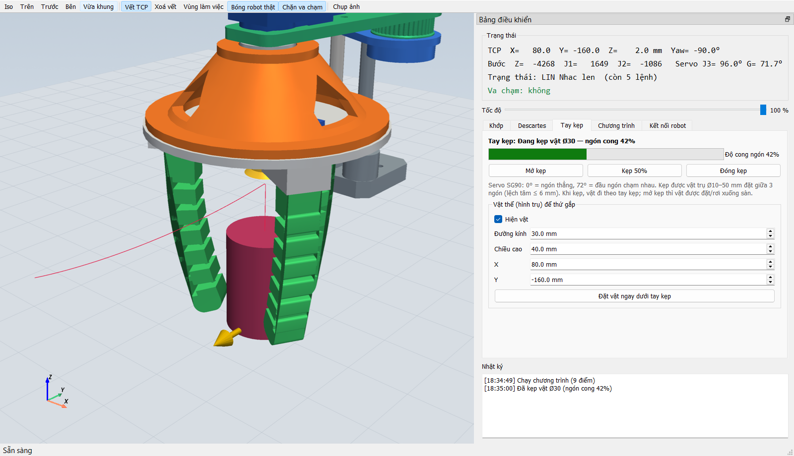
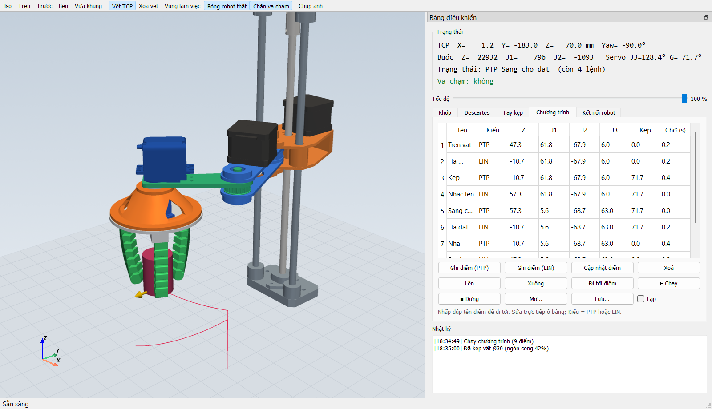

# Robot_TRRR



Robot SCARA tự chế, gồm một trục Z dùng vít me, hai khớp quay J1 và J2 dẫn bằng đai, cổ tay J3 dùng servo MG995 và tay kẹp mềm 3 ngón dùng servo SG90. Repo này chứa phần mềm của robot:

| Thư mục | Nội dung |
|---|---|
| [`digital_twin/`](digital_twin/README.md) | App **digital twin** viết bằng Python (PyQt5 + PyVista). App mô phỏng 3D robot và tay kẹp, có động học thuận/ngược, quỹ đạo PTP/LIN, dạy điểm, kiểm tra va chạm, và điều khiển robot thật qua Serial. |
| [`firmware/`](firmware/README.md) | Firmware **Arduino Nano**, dùng PlatformIO. Firmware điều khiển 3 stepper (A4988) và 2 servo, giao tiếp với app theo cùng một giao thức Serial. |

<table>
<tr>
<td width="50%"></td>
<td width="50%"></td>
</tr>
<tr>
<td align="center">Mô phỏng tay kẹp: ngón cong theo góc servo, dừng khi chạm vật</td>
<td align="center">Tay kẹp mềm 3 ngón: đế nối MG995, đế, ống cuộn cước, ngón chữ T</td>
</tr>
</table>

## 1. Chạy app digital twin

Cần Python 3.10 trở lên (đã thử với 3.12, trên Windows).

```bash
git clone https://github.com/HuYingTran/Robot_TRRR.git
cd Robot_TRRR/digital_twin
pip install -r requirements.txt
python app.py
```

Muốn mở app và chạy luôn chương trình mẫu gắp–đặt vật:

```bash
python app.py --demo
```

Chưa có robot thật vẫn thử được: vào tab **Kết nối robot**, chọn `SIM (robot ảo)` rồi bấm **Kết nối**.

Các tab trong app:
- **Khớp**: kéo từng khớp Z, J1, J2, J3 và kẹp.
- **Descartes**: nhập X, Y, Z, Yaw rồi cho robot chạy PTP hoặc LIN, hoặc jog từng bước.
- **Tay kẹp**: mở/đóng kẹp, đặt vật hình trụ để thử gắp.
- **Chương trình**: ghi điểm, chạy, lặp, lưu và mở file JSON.
- **Kết nối robot**: chọn cổng COM hoặc SIM, xem sai lệch giữa lệnh và vị trí thật.





Thông số robot (kích thước, giới hạn khớp, tốc độ, tỉ số truyền, tay kẹp) nằm trong [`digital_twin/robot_config.json`](digital_twin/robot_config.json).

## 2. Nạp firmware Arduino Nano

Cần [PlatformIO](https://platformio.org/install), cài dạng CLI hoặc extension trong VS Code.

```bash
cd Robot_TRRR/firmware
pio run -t upload
```

Đấu dây (shield CNC V4 cho Nano):

| Trục | STEP | DIR | Ghi chú |
|---|---|---|---|
| J1 (stepper 4238) | D5 | D2 | đai 20→60 |
| J2 (stepper 4239) | D6 | D3 | đai 20→36 |
| Z (stepper 4237) | D7 | D4 | vít me 8 mm/vòng |
| EN chung | D8 | | LOW = bật driver |
| J3 servo MG995 | D10 | | |
| Kẹp servo SG90 | D11 | | |

Driver A4988 đặt vi bước 1/16. Hai servo cần nguồn 5–6 V riêng, nối chung GND với Nano. Chi tiết và cách căn chỉnh xem trong [`firmware/README.md`](firmware/README.md).

## 3. Nối app với robot thật

1. **Đưa robot về home trước khi cấp nguồn.** Robot chưa có công tắc hành trình, nên vị trí lúc cấp nguồn được coi là home: tay duỗi thẳng theo hướng −Y, Z ở vị trí home.
2. **Kết nối:** cắm Nano qua USB. Trong app, vào tab **Kết nối robot**, chọn cổng COM, baud 115200, rồi bấm **Kết nối**.
3. **Kiểm tra chiều quay:** kéo nhẹ từng khớp ở tab **Khớp**. Trục nào quay ngược thì đổi cờ `invert` trong `firmware/src/main.cpp` rồi nạp lại.

Giao thức Serial (text, mỗi lệnh một dòng, đơn vị mm và độ, tính so với home):

| Hướng | Lệnh |
|---|---|
| PC → Nano | `J z j1 j2 j3 g` (setpoint, khoảng 20 Hz) · `H` về home · `S` dừng · `?` hỏi vị trí · `O` đặt lại home · `E 0/1` tắt/bật driver |
| Nano → PC | `P z j1 j2 j3 g` (vị trí, khoảng 20 Hz) · `OK` / `ERR ...` |

## Ghi chú

- File thiết kế FreeCAD (`robot.FCStd`, các chi tiết, tay kẹp `SoftGripper_SG90.FCStd`) **không** nằm trong repo này. App chỉ cần các mesh STL đã xuất sẵn trong `digital_twin/meshes/`.
- Khi sửa CAD, chạy [`digital_twin/export_meshes.py`](digital_twin/export_meshes.py) trong FreeCAD để xuất lại mesh, rồi commit thư mục `meshes/`.
